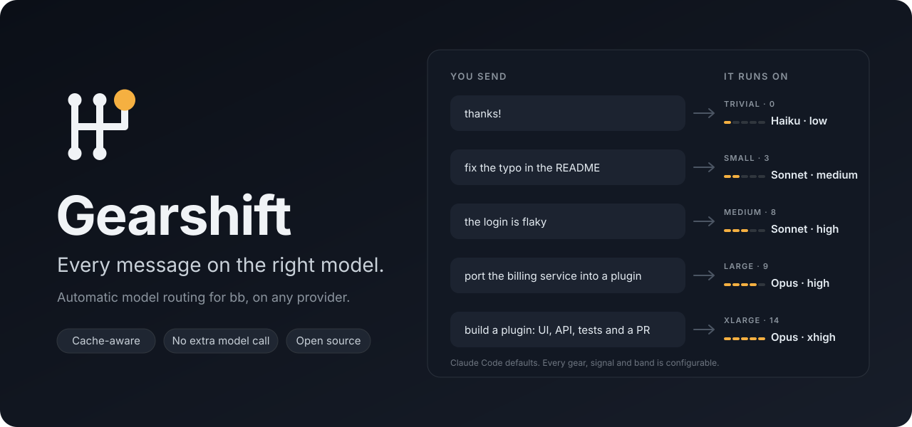
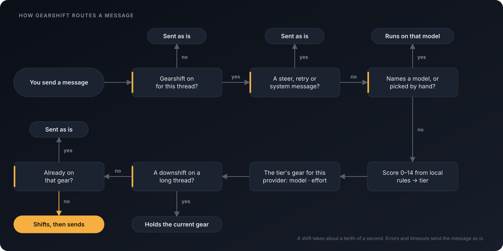
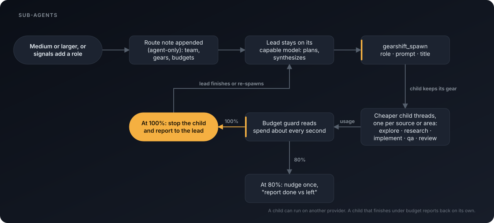

<p align="center">
  
</p>

<p align="center">
  <a href="#install"><b>Install</b></a>&nbsp;&nbsp;·&nbsp;&nbsp;
  <a href="docs/routing-policy.md"><b>Routing policy</b></a>&nbsp;&nbsp;·&nbsp;&nbsp;
  <a href="docs/how-it-works.md"><b>How it works</b></a>&nbsp;&nbsp;·&nbsp;&nbsp;
  <a href="CHANGELOG.md"><b>Changelog</b></a>&nbsp;&nbsp;·&nbsp;&nbsp;
  <a href="CONTRIBUTING.md"><b>Contributing</b></a>&nbsp;&nbsp;·&nbsp;&nbsp;
  <a href="https://github.com/sponsors/vanZeben">♥&nbsp;Sponsor</a>
</p>

<p align="center">
  <a href="https://github.com/vanZeben/bb-gearshift/releases"></a>
  <a href="https://github.com/vanZeben/bb-gearshift/actions/workflows/ci.yml"></a>
  
  <a href="LICENSE.md"></a>
</p>

---

**Gearshift is a [bb](https://getbb.app) plugin that runs every message on the model and reasoning effort its size calls for.**

A "thanks" doesn't need the top model at maximum effort, and a multi-file refactor shouldn't run on the smallest one. Gearshift reads each message as you send it, scores how much work it asks for, and shifts the thread to the gear that fits: a small, fast model for quick asks, the top model with more thinking for big builds. You see the gear before you send, and you can turn it off for any thread.

It also orchestrates. For a medium or larger message, Gearshift tells the agent which sub-agents to start (an implementer on a mid model, QA on a small one, a review on the top one), starts them on those models, and caps what each can spend. See [Sub-agents](#sub-agents).

## Why Gearshift

- **Pay for the work, not the habit.** Most messages in a coding session are follow-ups, acknowledgements and small fixes. Gearshift sends them to a cheaper gear and saves the top model for the work that needs it.
- **Orchestrates sub-agents.** Medium and larger messages come with a team: implementers, QA, review, even on another provider. Each sub-agent runs on its role's model with a token budget, and Gearshift stops it at the limit. Big work gets split across the right models instead of running on one.
- **Never wastes your cache.** Prompt caches belong to one model. Moving a long thread to a cheaper model makes it re-read its whole context uncached, which can cost more than the reply saves. Gearshift holds long threads on their current model and only shifts them up, while each message still gets its own effort: a "thanks" on a long Opus thread runs on Opus at low effort.
- **Works on every provider.** Built-in gears for Claude Code and Codex, and size-based gears for Pi, ACP agents and any other provider. Gears follow the provider's live model list, so new model releases are picked up without an update.
- **No extra model call.** Scoring is a handful of local rules: well under a millisecond, nothing sent anywhere, no hidden classification turn.
- **You stay in charge.** Pick a model by hand and that message keeps it. Write "use opus" in a message and it runs there. Every rule, signal and gear is a setting.
- **See what it did.** The composer shows where your draft will run and why. An analytics page shows every decision, the model mix, and the estimated savings.

## How it routes

<p align="center"></p>


A shift takes about a tenth of a second: bb holds the message for a moment, Gearshift sets its model and effort, and bb sends it on. If anything goes wrong, or a lookup takes longer than 1.5 seconds, the message goes through unchanged. [How it works](docs/how-it-works.md) has the details.

### Default gears

| Score | Tier | Example | Claude Code | Codex | Any other provider |
|---|---|---|---|---|---|
| 0–2 | trivial | "thanks!", "how does the queue work?" | Haiku · low | small model · low | small model · low |
| 3–5 | small | "fix the typo in the README" | Sonnet · medium | small model · medium | small model · medium |
| 6–8 | medium | "the login is flaky" | Sonnet · high | default model · medium | mid model · medium |
| 9–11 | large | "port the billing service into a plugin" | Opus · high | default model · high | large model · high |
| 12–14 | xlarge | "build a plugin: UI, API, tests and a PR" | Opus · xhigh | default model · xhigh | large model · xhigh |

"Small", "mid" and "large" are read from model names (`haiku`, `mini`, `flash`, `lite` are small; `opus`, `pro`, `ultra`, `max` are large), and the provider's default model is the mid gear. [The routing policy guide](docs/routing-policy.md) explains every signal behind the score and how to change it.

## Sub-agents

Routing picks the model for the message you send. Orchestration picks the models for the work that message turns into. For medium and larger messages, Gearshift lets the agent split the work across sub-agents, each on the gear its role needs.

<p align="center"></p>

**What the agent sees.** A short note on the message, invisible in the chat, for example:

```text
[gearshift] tier=large · score=10 · team: implementers; qa; review of the diff · roles: implement → Sonnet 5.5 · high (budget 700k), qa → Haiku 5.5 · low (budget 150k), review → Opus 5.5 · medium (budget 300k) · spawn sub-agents with the gearshift_spawn tool
```

The agent starts a sub-agent with the `gearshift_spawn` tool: a role, a prompt and an optional title. Gearshift creates a child thread on that role's model, effort and service tier, and the child reports back to the lead when it finishes. The agent can only spawn the roles in its note: the tier's team, plus research (on a research signal such as "compare" or "benchmark") and explore (on an investigation signal such as "flaky" or "root cause"). Sub-agents keep the gear they were given and are never re-routed.

**Default teams.**

| Tier | Team | Roles |
|---|---|---|
| trivial | answer directly, no sub-agents | none |
| small | one implementer, run tests directly | implement |
| medium | implementers on disjoint files + qa + verify | implement, qa, verify |
| large | implementers; qa; review of the diff | implement, qa, review |
| xlarge | architecture plans first, then the large team | architecture, implement, qa, review |

On Claude Code, `implement` runs on Sonnet (medium effort, high from medium up), `qa` and `verify` on Haiku, `review` on Opus and `architecture` on the top model. Other providers use the small, mid and large model classes. The default roles and their budgets per tier are in [the routing policy guide](docs/routing-policy.md#teams-and-sub-agents).

**Budgets.** Every sub-agent has a token budget that depends on its role and the message's tier, for example 700k for an `implement` run on a large message and 150k for `qa`. Spend counts input, cache writes and output tokens, plus a tenth of cache reads. At 80% Gearshift tells the sub-agent to wrap up and report what is done and what is left. At 100% it stops the thread and sends a run report to the lead, marked incomplete, with the sub-agent's last output. Enforcement follows bb's event cadence, about once a second, so a run can overshoot: a live test stopped a 30k-budget run at 41k. At real budgets (100k and up) the overshoot is small.

**Other providers.** A role can run on a different provider than the lead, for example a review on Codex while the lead runs on Claude Code. Set a provider override on the role's gear in the Teams tab.

**See and edit it.** Teams, roles, gears and budgets live in the **Teams** tab of the Routing policy editor. The analytics page has a **Sub-agents** card: lead against sub-agent spend, runs by role, how much of its budget each run used, and the most recent runs.

**Turn it off.** Switch off **Add a team note to medium and larger messages** and the agent is no longer told the team or its roles, so it has nothing to orchestrate with (`bb plugin config gearshift set routeNotes false` does the same). Turning Gearshift off for a thread also stops it spawning there.

**Not covered.** Claude Code's built-in Agent tool starts sub-agents inside the lead's own session. They are not bb threads, so Gearshift cannot see or route them. Only sub-agents started with `gearshift_spawn` get a role's model and budget. [How it works](docs/how-it-works.md#sub-agents) has the internals.

## Install

From bb: **Settings → Plugins**, search for **Gearshift**, and install.

From a terminal:

```sh
bb plugin install git:https://github.com/vanZeben/bb-gearshift.git@^0
```

Gearshift needs bb 0.50 or later. It has no account, API key or external service: it runs inside your bb server.

## Quick start

1. **Send a message in any thread.** The gear pill next to the send button shows where it will run, for example `Auto · Sonnet 5.5 · High`, and updates as you type.
2. **Click the pill** to see why: the score, the signals that matched, and the last shift. The switch there turns Gearshift off for that thread.
3. **Open Gearshift in the sidebar** for the analytics page: messages routed, shift rate, tier and model mix, daily cost against always using the top gear, and recent decisions. **Improve my rules** in its header opens a new thread with a review prompt: an agent reads your routing history, judges whether each gear fit, and proposes changes you approve one by one.
4. **Try orchestration.** Send a medium or larger task, such as "port the billing service into a plugin". The agent gets a team note and can start sub-agents. Open **Gearshift** in the sidebar and look at the **Sub-agents** card for their spend, and at the **Teams** tab in the policy editor to change who runs on what.
5. **Tune it** in **Settings → Plugins → Gearshift**. The **Try a message** box shows how a draft would route before you save.

## Configuration

Everything is an ordinary setting in **Settings → Plugins → Gearshift**. There is nothing to write by hand.

| Setting | Default | What it does |
|---|---|---|
| Enable Gearshift | on | Master switch. |
| Start new threads with Gearshift on | on | Turn this off to route only the threads you switch on yourself. |
| A model picked by hand wins | on | If you change the model picker before sending, that message keeps your choice. |
| Route messages from other agents | on | Also route messages that other agents send into a thread. |
| Don't downshift above this many context tokens | 60,000 | Keeps long threads on their current model so their cache isn't wasted. 0 turns this off. |
| Add a team note to medium and larger messages | on | Tells the agent which sub-agent roles to spawn and on what. Off means no orchestration prompts. |
| Days of history kept | 90 | Routing history used by the analytics page. |

Below them, the **Routing policy** editor sets the gears for each provider (model, effort and service tier per tier), the scoring signals and score bands, with Gearshift's defaults filled in. Your changes sit on top of the defaults, so you keep getting improved defaults for everything you didn't change. See [the routing policy guide](docs/routing-policy.md).

### Tuning from your own usage

Not sure which numbers to change? Open the analytics page and click **Improve my rules**. It starts a new thread whose first message asks an agent to run `bb gearshift review`, judge from your own history whether the gears fit, and propose a short list of changes. Nothing is applied until you approve it, and every change can be reverted in the editor. See [Let an agent tune it](docs/routing-policy.md#tuning-recipes).

## Commands

Gearshift adds a `bb gearshift` command, and ships a skill so agents can use it:

```sh
bb gearshift status [--thread <id>]               # is it on, and the last decision
bb gearshift on --thread <id>                     # turn it on for a thread
bb gearshift off --thread <id>                    # turn it off for a thread
bb gearshift explain "<text>" [--provider <id>]   # how a message would score, no side effects
bb gearshift policy                               # the routing policy in effect
bb gearshift review [--days N] [--json]           # routing report: tiers, holds, likely over- and under-sized gears
bb gearshift replay [--days N] [--set path=value]  # what your history would cost under the current or a changed policy
bb gearshift policy set <path> <value>            # change one policy value, e.g. tiers.large.max 12
bb gearshift policy unset <path>                  # restore one value to its default
bb gearshift policy add-pattern <classId> <regex> # add a scoring pattern to a signal class
bb gearshift policy remove-pattern <classId> <regex>
bb plugin config gearshift set defaultOn false    # change a setting
```

## FAQ

<details>
<summary><b>Does it cost anything, or need an API key?</b></summary>

No. Gearshift is free and open source, and it runs inside your bb server with no account or key. It only chooses which of your provider's models a message runs on.
</details>

<details>
<summary><b>I'm on a subscription plan. Does it still help?</b></summary>

Yes. A smaller model and lower effort use less of your plan's limits and usually answer sooner. The cost figures on the analytics page are estimates at public API list prices, so on a subscription read them as relative cost, not as your bill.
</details>

<details>
<summary><b>Will switching models break my prompt cache?</b></summary>

Gearshift is built around that. Caches belong to one model, and on Anthropic models changing the effort mid-conversation can invalidate the message cache too. So Gearshift never moves a thread whose context is above 60,000 tokens (configurable) down to a cheaper gear. It only shifts long threads up, when a message needs more capability.
</details>

<details>
<summary><b>What if I want a specific model?</b></summary>

Pick it in the composer's model picker and that message keeps it. You can also write "use opus" or "with haiku" in the message, or turn Gearshift off for the thread from its pill.
</details>

<details>
<summary><b>Does it send my messages anywhere, or store them?</b></summary>

No. Scoring happens locally in the bb server. Gearshift stores each decision's metadata for analytics (tier, signals, models, token counts, message length), never the message text, and nothing is sent to any service.
</details>

<details>
<summary><b>How is this different from a router that asks a model to classify the task?</b></summary>

There's no extra model call: no added latency, no tokens spent deciding, and nothing leaves your machine. Gearshift decides per message rather than once per thread, and it knows about prompt caches. The trade-off is that rules are simpler than a model's judgment, which is why every signal is visible and editable.
</details>

<details>
<summary><b>Can it move a thread to a different provider?</b></summary>

No. bb fixes a thread's provider when the thread starts, so Gearshift shifts between that provider's models.
</details>

<details>
<summary><b>Does Gearshift route the sub-agents Claude Code's Agent tool starts?</b></summary>

No. Claude Code's built-in Agent-tool sub-agents run inside the lead's own session and are not bb threads, so Gearshift cannot see or route them. Only sub-agents started with `gearshift_spawn` get a role's model and budget.
</details>

## Contributing

Bug reports, ideas and pull requests are welcome. [CONTRIBUTING.md](CONTRIBUTING.md) covers the dev setup, the project layout and the design rules a change has to keep, and [docs/how-it-works.md](docs/how-it-works.md) explains the internals. Please read the [code of conduct](CODE_OF_CONDUCT.md) first. For security issues, see [SECURITY.md](SECURITY.md).

## Support the project

Gearshift is built and maintained in spare time. If it saves you money or limits, you can [sponsor its development on GitHub](https://github.com/sponsors/vanZeben). Stars, bug reports and good first pull requests help too.

## License

[MIT](LICENSE.md)
