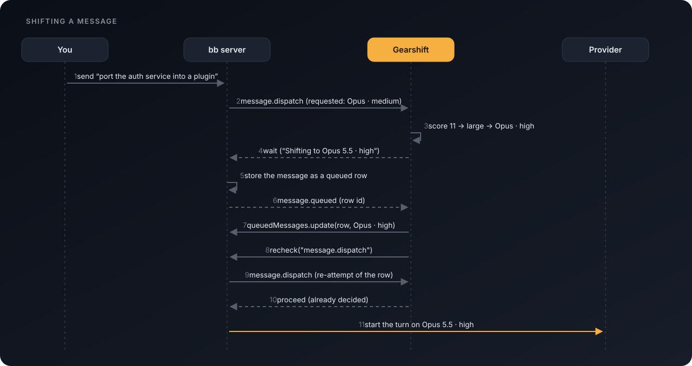
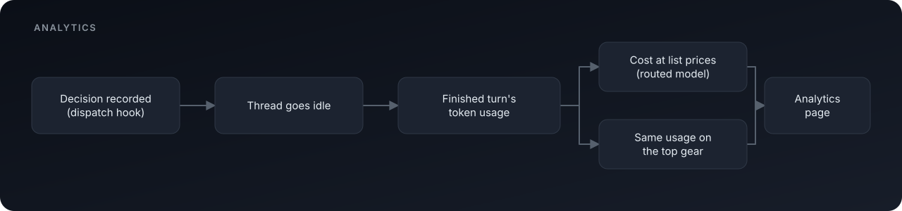

# How Gearshift works

This page is for people who want to understand or change Gearshift's internals. For what
the routing rules do, read [the routing policy guide](routing-policy.md). The precise
contracts between the pieces (RPC schemas, storage schema, decision rules) live in
[DESIGN.md](DESIGN.md).

- [Architecture](#architecture)
- [Shifting a message](#shifting-a-message)
- [Sub-agents](#sub-agents)
- [Fail-open guarantees](#fail-open-guarantees)
- [Data and privacy](#data-and-privacy)
- [Analytics](#analytics)
- [Reviewing routing](#reviewing-routing)
- [Extending Gearshift](#extending-gearshift)

## Architecture

Gearshift is a standard bb plugin: a server entry that runs inside the bb server, and an app
entry that renders inside the bb UI. They talk over the plugin's typed RPC and one realtime
channel.

Everything in `lib/` is pure and synchronous where it can be, and is where most of the tests
live. `server.ts` wires those modules to bb: it registers the hook, the event listeners, the
RPC handlers, the settings and the CLI, and does the I/O.

## Shifting a message

bb asks every plugin hook about each message before it reaches a provider
(`bb.experimental_hooks.on("message.dispatch")`). A hook can answer `proceed`, `wait` or
`reject`, but it can't edit the message. Gearshift therefore shifts gears in three steps:

- A queued row is sent with its **own** model and reasoning level, so amending the row is
  what changes the turn's model.
- When the message is already on the right gear, the hook answers `proceed` straight away:
  no queue, no delay. A shift takes roughly a tenth of a second end to end.
- **Re-attempts never re-decide.** bb re-asks the hook whenever a queued row is retried
  (after a thread-busy wait, a restart, or a recheck). Gearshift links every queued row to the
  decision that created it (`queued_links`, filled from the `message.queued` event) and
  answers `proceed` for any linked row. A model you picked by hand therefore survives a
  queue wait, and two identical messages still make two decisions.
- **Long threads hold their model, not their effort.** Above the hold threshold a message is
  still scored on its own: it keeps the thread's model (a switch would re-read the context
  uncached) but runs at its own tier's effort when that is lower, never higher, and never below
  medium for large and x-large work. A trivial or small message leaves the model only when one
  turn on the cheaper model costs less, re-read included. Claude Code sends the effort inside
  the conversation at the turn where it changes, so on current models an effort change keeps
  the prompt cache. Each decision records its hold kind (`gear`, `effort`, `continuation` or
  `downshift`) and, for a hold, the decision it inherited from. The rule is in
  [the routing policy guide](routing-policy.md#why-long-threads-hold).
- **Rows are amended by id.** For a grouped drain the row ids come from `ctx.queuedMessages`,
  and every row in the group is amended. A row whose text doesn't match the decision is
  never touched, whichever plugin owns its wait.

## Sub-agents

Gearshift also orchestrates. For a medium or larger message it tells the agent which sub-agents to start, starts them on the gear each role needs, and watches what they spend. For what this looks like to a user, see [Sub-agents in the README](../README.md#sub-agents); for the policy keys, see [Teams and sub-agents](routing-policy.md#teams-and-sub-agents).

### The route note

The same dispatch hook that picks the gear also decides whether to add a note. It adds one when all of these hold:

- the **Add a team note** setting (`routeNotes`) is on;
- it is the first attempt of a turn (`start-turn`), sent by a user or another agent;
- the tier is medium, large or xlarge;
- the decision is a shift, keep or hold. A model you picked by hand is never held just to add a note.

The note is one line: the tier, the score, the team's summary, and each role with its resolved model, effort, provider (if not the lead's) and token budget. The roles are the tier's team plus the roles its signals add (`signalRoles`). A role on another provider is resolved against that provider's model list, so the hook may load more than one list.

The note rides on the amend that carries a gear shift. It is added to the queued row as an `agent-only` text block that starts with `[gearshift]`, so bb's UI does not show it. When there is no gear change the amend is note-only and the hook still waits once ("Adding the team note"). A row that already has a note is never amended twice. Blocks that start with `[gearshift]` are stripped before scoring and fingerprinting, so a re-attempt never classifies Gearshift's own text.

### What `gearshift_spawn` does

The agent calls `gearshift_spawn` with a `role`, a `prompt` and an optional `title`. Step by step:

1. **Checks.** Gearshift must be on for the thread. The caller must not itself be a sub-agent (no grandchildren). The parent may have at most 6 open sub-agents, and at most 20 are open overall.
2. **Picks the tier.** It takes the tier of the parent's newest medium-or-larger decision, or medium if there is none.
3. **Checks the role.** The role must exist, and it must be in that tier's team or in the signal roles stored with that decision. Otherwise the tool returns an error that lists the allowed roles.
4. **Resolves the gear.** It reads the role's gear for the parent's provider (falling back to `"*"`), uses `effortMediumUp` from the medium tier up, and resolves the model against the target provider's list. A role with a provider override loads that provider's list. If nothing matches, the spawn fails.
5. **Creates the thread.** It calls bb's `threads.spawn` with the parent as `parentThreadId`, the parent's environment reused, the role's provider, model, effort and service tier, and your prompt.
6. **Records the run.** A row in the `runs` table holds the parent and child ids, role, tier, provider, model, effort and budget. The tool answers with the child's thread id, its gear and its budget.

### How the gear is pinned

The child is spawned with `executionInputSources` set to `explicit` for the provider, model, effort and service tier, so bb treats the gear as chosen. The dispatch hook then proceeds without deciding for any thread in `runs`. The child's first message can reach the hook before `spawn` returns and the run row exists, so Gearshift also lets through a child of a spawn that is in flight for up to a minute. `bb.agents.configure` withholds the `gearshift_spawn` tool from sub-agents and from threads where Gearshift is off.

### The budget guard

Only threads in `runs` are watched. The guard runs on thread events (bb batches these to about one a second), when a thread becomes active and when it goes idle.

**Reading usage.** Spend is in tokens: input, plus cache writes, plus output, plus 0.1 of cache reads. The settled figure is the total from the child's latest token-usage event. That event does not move while a turn runs, so the guard adds an estimate: how much the child's context window has grown since that total was recorded.

**Acting on it.**

| Spend | What happens |
|---|---|
| under 80% | nothing |
| 80% | once: the run becomes `nudged` and the child is steered with "Budget at 80%: finish the current step, then report done vs left." |
| 100% | the run becomes `stopped` and is flagged over budget; the child thread is stopped; its last output is read |
| turn ends first | the run becomes `done`. If the last turn crossed 100% it is flagged over budget but not stopped |

A budget of 0 never triggers. A child that is given another turn after it is `done` is guarded again. Each change of status is claimed in SQL first (`UPDATE ... WHERE status IN (...)`) and acted on only by the caller whose update changed a row, so a nudge or a report goes out once even when two events arrive together.

**The run report.** On a stop, Gearshift sends a message to the parent thread, queued behind its current turn and sent from the child. It starts with `[gearshift] run report`, names the role, child and the spend against the budget, and says the work is incomplete and the output may end mid-sentence. It ends with the child's last output, cut to 1,500 characters. The lead then finishes the work, spawns again with a smaller task, or raises the role's budget. Gearshift never routes its own report. A child that finishes under budget reports back to the lead on its own and gets no report from Gearshift.

**Limits.** Enforcement follows bb's event cadence, so a fast child can overshoot by a second or so of work. A live test stopped a 30k-budget run at 41k. At budgets of 100k and up the overshoot is small next to the budget. The in-turn figure is an estimate and undercounts re-read context.

### What is stored

- The **`runs`** table, one row per sub-agent: ids, role, tier, provider, model, effort, budget, spend, status (`running`, `nudged`, `done`, `stopped` or `failed`), an over-budget flag, and start and end times. Open runs are kept; finished ones are deleted with the rest of the history after the retention window.
- The signal roles of each **decision**, so a later spawn can be checked against the message that earned them.

Prompts, outputs and report text are not stored. The analytics Sub-agents card reads `runs` and the token usage of the lead threads.

### Fail-open and limits

- If the note cannot be built within the hook's shared 1.5-second lookup budget, or building it throws, the message goes through without a note. A failed amend releases the row anyway.
- A failed spawn returns an error to the agent as a tool result. Nothing is half-created: the run row is written only after the thread exists.
- Every call the guard makes to bb is time-boxed (4 seconds), and a guard error is logged and dropped. It never blocks a message.
- A sub-agent whose thread is archived, deleted or fails never reports, so its run is closed as `failed`. An open run older than 6 hours is failed as stale.
- Limits: 6 open sub-agents per parent thread and 20 overall; no sub-agent spawns another.
- Only `gearshift_spawn` sub-agents are covered. Claude Code's built-in Agent tool runs inside the lead's session and is not a bb thread, so Gearshift cannot see or route it.

## Fail-open guarantees

Gearshift may only ever change *which model* a message runs on. It must never lose, delay
for long, duplicate or refuse a message.

| Risk | Guard |
|---|---|
| A slow bb call inside the hook | Every lookup in the hook (model list, current gear, context size) shares one 1.5-second race; on timeout the message goes through unchanged. bb runs hooks under a server-wide lock, so nothing in the hook may wait without a bound. |
| An exception | The hook body is wrapped; any error answers `proceed`. Gearshift never answers `reject`. |
| A user regex that backtracks | Policy validation rejects nested or adjacent repeats such as `(\w+)+` and patterns over 500 characters; scanning stops after 2,000 characters for system-message patterns and 8,000 for scoring. |
| An amend that can't find its row | A poll looks for the row by exact text fingerprint for up to 5 seconds, then marks the decision `failed` and releases the row anyway. |
| Waiting twice | A row linked to a decision is always released, even if its amend failed. |
| The plugin stops or is removed | bb's orphan sweep releases any row still waiting on Gearshift. |

## Data and privacy

Gearshift stores, in its own SQLite database inside bb's data directory:

- one **decision** per message: time, thread and project ids, provider, tier, score,
  confidence, signal names, message length, requested and routed model/effort/service tier,
  context size, hold delay, and, after the turn, its token usage and estimated cost;
- **thread preferences** (on/off per thread);
- **queue links** (queued row id → decision id);
- the **policy overrides** you saved (plugin key-value storage).

It never stores message text. While you have Gearshift switched off in an unsent new-thread
composer, the draft's text is held **in memory** for up to 15 minutes so the first message
can be matched to your choice; it is never written to disk. Gearshift makes no network
requests. Decisions older than the retention setting (90 days by default) are deleted daily.

## Analytics

When a thread goes idle, Gearshift reads the finished turn's token usage from bb's thread
events and attaches it to the decision that started the turn. Cost uses built-in public list
prices (`DEFAULT_POLICY.prices`); the "top gear" comparison prices the same usage at the
provider's xlarge gear. Models without a known price are counted in tokens only.

## Reviewing routing

`bb gearshift review [--days N] [--json]` turns the stored decisions of a period into a report:
messages per tier and action, output-token percentiles per tier, cost per gear, how much cost
sits in held turns (by hold kind, and the origin turns whose gear the holds carried),
hand-picked models, routed messages that look oversized or undersized for the work they
produced (marked held or not, with the gear they inherited), how reliably each signal predicts
large work, when the policy last changed and how many decisions predate it, and a few hints
with their evidence numbers. It reads only stored metadata (lengths, signals, scores, token
usage and thread ids). No message text exists in storage, so the report cannot contain any.
Thread titles are looked up from bb when the report runs and are not stored.

`bb gearshift replay [--days N] [--set <path>=<value>]... [--json]` (or `review --replay`)
re-runs the same decisions under the current policy and hold rule, or under hypothetical edits,
and prints before/after tier shares, holds and estimated cost. Because messages aren't stored,
it can't re-score them: score bands, gears, efforts and the hold rule replay; scoring-rule
changes don't. Costs reuse each turn's recorded usage on the new gear, and the report says
which parts are estimated.

The **Improve my rules** button on the analytics page opens a new-thread draft that asks an
agent to run the report and propose changes. The agent opens one of the listed threads only if
you agree, and applies only the changes you approve.

## Extending Gearshift

**Better defaults for a provider.** Add a `gears.<providerId>` entry to `DEFAULT_POLICY` in
`lib/policy.ts`, with a test in `lib/gears.test.ts` that resolves it against a realistic
catalog for that provider.

**A new scoring signal.** Add a class to `scoring.classes` in `DEFAULT_POLICY` (an `id`,
a `label`, `patterns`, and a `floor` or `add`), then add its examples to the worked-examples
tests in `lib/classify.test.ts`. Every pattern must pass `validatePolicy`.

**A new decision rule.** Rules live in `lib/router.ts` (`decide`). Keep it pure, add the
rule to the table in [DESIGN.md](DESIGN.md#decision-rules-librouterts-pure) and a test per
outcome in `lib/router.test.ts`.

**A new RPC or UI surface.** Add the method and its schemas to `lib/contract.ts`, implement
it in `server.ts`, and import only types from `lib/contract.ts` in the app. Runtime values the
app needs go in SDK-free modules such as `lib/channels.ts`: marketplace installs have no dev
dependencies, and the app bundle can't resolve `@get-bb/plugin-sdk`.

See [CONTRIBUTING.md](../CONTRIBUTING.md) for the dev loop and the checks a pull request
must pass.
