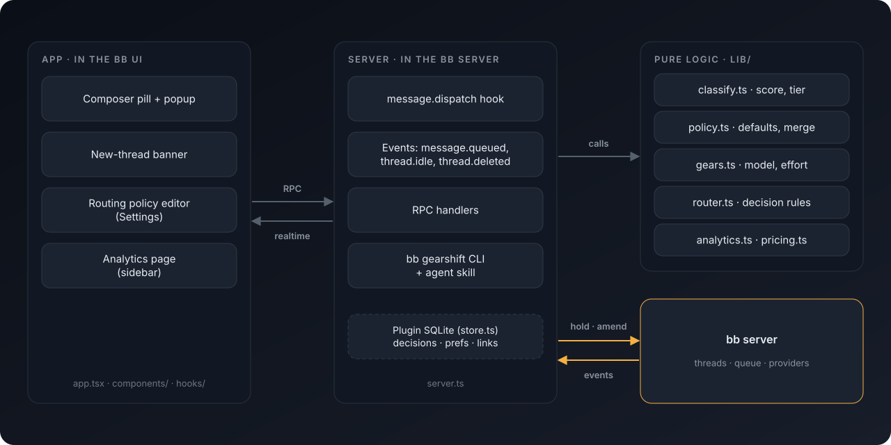

# How Gearshift works

This page is for people who want to understand or change Gearshift's internals. For what
the routing rules do, read [the routing policy guide](routing-policy.md). The precise
contracts between the pieces (RPC schemas, storage schema, decision rules) live in
[DESIGN.md](DESIGN.md).

- [Architecture](#architecture)
- [Shifting a message](#shifting-a-message)
- [Fail-open guarantees](#fail-open-guarantees)
- [Data and privacy](#data-and-privacy)
- [Analytics](#analytics)
- [Extending Gearshift](#extending-gearshift)

## Architecture

Gearshift is a standard bb plugin: a server entry that runs inside the bb server, and an app
entry that renders inside the bb UI. They talk over the plugin's typed RPC and one realtime
channel.

Everything in `lib/` is pure and synchronous where it can be, and is where most of the tests
live. `server.ts` wires those modules to bb: it registers the hook, the event listeners, the
RPC handlers, the settings and the CLI, and does the I/O.

## Shifting a message

bb asks every plugin hook about each message before it reaches a provider
(`bb.experimental_hooks.on("message.dispatch")`). A hook can answer `proceed`, `wait` or
`reject`, but it can't edit the message. Gearshift therefore shifts gears in three steps:

- A queued row is sent with its **own** model and reasoning level, so amending the row is
  what changes the turn's model.
- When the message is already on the right gear, the hook answers `proceed` straight away:
  no queue, no delay. A shift takes roughly a tenth of a second end to end.
- **Re-attempts never re-decide.** bb re-asks the hook whenever a queued row is retried
  (after a thread-busy wait, a restart, or a recheck). Gearshift links every queued row to the
  decision that created it (`queued_links`, filled from the `message.queued` event) and
  answers `proceed` for any linked row. A model you picked by hand therefore survives a
  queue wait, and two identical messages still make two decisions.
- **Rows are amended by id.** For a grouped drain the row ids come from `ctx.queuedMessages`,
  and every row in the group is amended. A row whose text doesn't match the decision is
  never touched, whichever plugin owns its wait.

## Fail-open guarantees

Gearshift may only ever change *which model* a message runs on. It must never lose, delay
for long, duplicate or refuse a message.

| Risk | Guard |
|---|---|
| A slow bb call inside the hook | Every lookup in the hook (model list, current gear, context size) shares one 1.5-second race; on timeout the message goes through unchanged. bb runs hooks under a server-wide lock, so nothing in the hook may wait without a bound. |
| An exception | The hook body is wrapped; any error answers `proceed`. Gearshift never answers `reject`. |
| A user regex that backtracks | Policy validation rejects nested or adjacent repeats such as `(\w+)+` and patterns over 500 characters; scanning stops after 2,000 characters for system-message patterns and 8,000 for scoring. |
| An amend that can't find its row | A poll looks for the row by exact text fingerprint for up to 5 seconds, then marks the decision `failed` and releases the row anyway. |
| Waiting twice | A row linked to a decision is always released, even if its amend failed. |
| The plugin stops or is removed | bb's orphan sweep releases any row still waiting on Gearshift. |

## Data and privacy

Gearshift stores, in its own SQLite database inside bb's data directory:

- one **decision** per message: time, thread and project ids, provider, tier, score,
  confidence, signal names, message length, requested and routed model/effort/service tier,
  context size, hold delay, and, after the turn, its token usage and estimated cost;
- **thread preferences** (on/off per thread);
- **queue links** (queued row id → decision id);
- the **policy overrides** you saved (plugin key-value storage).

It never stores message text. While you have Gearshift switched off in an unsent new-thread
composer, the draft's text is held **in memory** for up to 15 minutes so the first message
can be matched to your choice; it is never written to disk. Gearshift makes no network
requests. Decisions older than the retention setting (90 days by default) are deleted daily.

## Analytics

When a thread goes idle, Gearshift reads the finished turn's token usage from bb's thread
events and attaches it to the decision that started the turn. Cost uses built-in public list
prices (`DEFAULT_POLICY.prices`); the "top gear" comparison prices the same usage at the
provider's xlarge gear. Models without a known price are counted in tokens only.

## Extending Gearshift

**Better defaults for a provider.** Add a `gears.<providerId>` entry to `DEFAULT_POLICY` in
`lib/policy.ts`, with a test in `lib/gears.test.ts` that resolves it against a realistic
catalog for that provider.

**A new scoring signal.** Add a class to `scoring.classes` in `DEFAULT_POLICY` (an `id`,
a `label`, `patterns`, and a `floor` or `add`), then add its examples to the worked-examples
tests in `lib/classify.test.ts`. Every pattern must pass `validatePolicy`.

**A new decision rule.** Rules live in `lib/router.ts` (`decide`). Keep it pure, add the
rule to the table in [DESIGN.md](DESIGN.md#decision-rules-librouterts-pure) and a test per
outcome in `lib/router.test.ts`.

**A new RPC or UI surface.** Add the method and its schemas to `lib/contract.ts`, implement
it in `server.ts`, and import only types from `lib/contract.ts` in the app. Runtime values the
app needs go in SDK-free modules such as `lib/channels.ts`: marketplace installs have no dev
dependencies, and the app bundle can't resolve `@get-bb/plugin-sdk`.

See [CONTRIBUTING.md](../CONTRIBUTING.md) for the dev loop and the checks a pull request
must pass.
