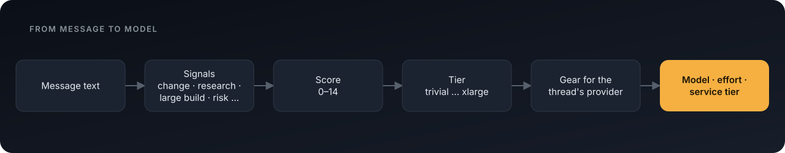

# The routing policy

Everything Gearshift decides comes from one **routing policy**: how a message is scored, how
scores map to tiers, which model and effort each tier runs on for each provider, and when a
thread holds its gear. Gearshift ships a complete default policy. Your changes are stored on
top of it, so you keep receiving improved defaults with every release for everything you
did not change.

You edit the policy in **Settings → Plugins → Gearshift**: plain switches at the top, then
the **Routing policy** editor with three tabs (**Gears**, **Scoring**, **Try a message**).
`bb gearshift policy` prints the policy in effect, and `bb gearshift explain "<text>"` shows
how one message scores.

- [From message to model](#from-message-to-model)
- [Scoring](#scoring)
- [Tiers](#tiers)
- [Gears](#gears)
- [When Gearshift does not shift](#when-gearshift-does-not-shift)
- [Tuning recipes](#tuning-recipes)

## From message to model

1. Gearshift reads only the words you wrote. bb's envelopes, system reminders, attachment
   notes and pasted blocks are set aside first (a long paste still counts towards size).
2. **Signals** in the text build a **score** from 0 to 14.
3. The score falls in one of five **tiers**.
4. The tier picks a **gear** for the thread's provider: a model, a reasoning effort, and
   optionally a service tier such as fast mode.
5. A few [rules](#when-gearshift-does-not-shift) can still keep the current gear, for example
   on a long thread.

## Scoring

A score is a **base**, plus **additions**, plus **bonuses**, capped at 14.

### Base: what kind of ask it is

Each signal class has a list of patterns. A class with a **floor** sets the base when it
matches; if several match, the highest floor wins.

| Signal | Floor | Matches, for example |
|---|---|---|
| change | 3 | fix, rename, bump, typo, update, add, implement, create, write, change, remove, make, move, delete, wire, configure, install |
| research | 6 | research, compare, benchmark, evaluate, trade-off, market |
| large build | 9 | build a …, port … into/to/from …, redesign, refactor, migrate (the verb; "migration" is not a trigger), architect, overhaul, rewrite, re-implement, end-to-end, from scratch, a new system / service / app / plugin |

"build" is matched with care: "fix the build", "the build is slow" and "CI build failed" do
not count as a large build.

When no floor class matches:

- a **question** ("how does…", "what is…", "…?") starts at **1**;
- anything else starts at **3** (small), with low confidence, so an unclear ask gets a
  capable mid-size model rather than the smallest one.

Two shortcuts come first:

- **Acknowledgements** ("thanks", "ok", "lgtm", 👍) of up to 60 characters score **0**. So does a
  short message that *starts* with a thank-you or an approval and only closes the conversation
  ("thanks for the help, that works", "great, that works", "perfect, thanks"), provided nothing in it
  matches a signal class or a question. Anything that asks for more stays scored normally: "ok, fix the
  login", "great, now add tests", "thanks, now rewrite it" and "thanks, can you also delete the old
  branch?" are not acknowledgements.
- **Continuations** ("continue", "go ahead", "yes, do it") of up to 80 characters keep the
  thread's current gear.

### Additions: what makes it harder

| Signal | Adds | Matches, for example |
|---|---|---|
| investigation | +3 | slow, figure out, investigate, debug, root cause, intermittent, sometimes, flaky, leak, crash, "why is / does …" |
| breadth | +3 | every, across, entire, whole, everywhere, "all the …s" |
| risk | +2 | production, deploy to prod, drop table, delete, secrets, credentials, customer data, PII, payments, refunds, force-push, rm -rf, publish, release, auth, SSO, SAML, OAuth, login, sessions |

### Bonuses: how much it touches

| Bonus | Adds |
|---|---|
| Areas of a codebase: backend, frontend, data, auth, tests, infra, docs, delivery (PR, release notes) | +2 for each area after the first, up to +6 |
| Three or more file paths (`src/app.ts`, `docs/README.md`, …) | +2 |
| Long message: over 500 characters / over 1,500 characters | +1 / +2 |

### Worked examples

These are the default policy's real scores (`bb gearshift explain` prints the same breakdown):

| Message | How the score adds up | Score | Tier |
|---|---|---|---|
| thanks! | acknowledgement | 0 | trivial |
| thanks for the help, that works | acknowledgement | 0 | trivial |
| how does the queue work? | question 1 | 1 | trivial |
| fix the typo in the README | change 3 | 3 | small |
| rename getUser to fetchUser in api/users.ts | change 3 | 3 | small |
| why is the build slow on CI? | question 1 + investigation 3 | 4 | small |
| delete the old migration files | change 3 + risk 2 | 5 | small |
| research which models are good for which tasks | research 6 | 6 | medium |
| the login is flaky | no clear signal 3 + investigation 3 + risk 2 | 8 | medium |
| port the billing service into a plugin | large build 9 | 9 | large |
| update the docs, the tests and the CI pipeline for the new auth flow | change 3 + risk 2 + 3 areas 4 | 9 | large |
| build a plugin: UI, API, tests and a PR | large build 9 + 4 areas 6 (capped at 14) | 14 | xlarge |

The **Try a message** tab runs this on your draft policy, before you save, and shows the
gear each provider would use.

## Tiers

| Tier | Score band (default) | Meant for |
|---|---|---|
| trivial | 0–2 | acknowledgements, quick questions |
| small | 3–5 | one focused change |
| medium | 6–8 | an investigation, research, or a change across a few places |
| large | 9–11 | a multi-part feature or migrating a system |
| xlarge | 12–14 | a broad build across several layers |

The bands must start at 0 and be contiguous. Move them to make Gearshift more or less
willing to reach for the bigger gears.

### Leaning lower on borderline messages

With **Lean to the lower tier on borderline messages** on (`downshiftBias`, the default), a
message routes one tier lower than its band when:

- its score is the lowest point of its band (a 9 is the bottom of large, one point above
  medium), or
- no signal matched (low confidence), so the score is a guess.

It moves at most one tier and never up; trivial stays trivial. A message with no signal scores
3, the bottom of small, so it runs on the trivial gear. A model named in the message, a model
you picked by hand, and a continuation are not affected, and the hold rule below runs on the
lower tier. The score and the tier before the lean are recorded, so `bb gearshift review`
and `bb gearshift replay --set routing.downshiftBias=false` show what it changed. Switch it
off with `bb plugin config gearshift set downshiftBias false`.

## Gears

A gear is a **model**, an **effort** and an optional **service tier**, set per provider and
per tier. "All other providers" covers any provider without its own row.

### Defaults

| Tier | Claude Code | Codex | All other providers |
|---|---|---|---|
| trivial | haiku · low | smallest model · low | smallest model · low |
| small | sonnet · medium | smallest model · medium | smallest model · medium |
| medium | sonnet · high | provider default · medium | mid model · medium |
| large | opus · high | provider default · high | largest model · high |
| xlarge | opus · xhigh | provider default · xhigh | largest model · xhigh |

### Choosing a model

The model in a gear can be:

| Choice | Means |
|---|---|
| A specific model, e.g. `claude-sonnet-5-5` | exactly that model |
| A family word, e.g. `sonnet`, `mini` | the newest model whose name contains it |
| Provider default | the model the provider marks as its default |
| Smallest / mid / largest model | read from model names: `haiku`, `mini`, `nano`, `flash`, `lite`, `small`, `tiny`, `spark`, `instant` are small; `opus`, `fable`, `mythos`, `ultra`, `large`, `pro`, `max`, `xl` are large; everything else is mid, and the provider default is the preferred mid model |

Gears are resolved against the provider's live model list each time, so a family word or a
size keeps working when the provider ships a new version.

### Effort and service tier

- **Effort** is clamped to what the chosen model supports: if a model has no `xhigh`,
  Gearshift uses the closest level it has, preferring the lower one on a tie. It never picks a
  provider-specific level such as Claude Code's `ultracode` unless you set it explicitly.
- **Service tier** (for example `fast`) is applied only when the chosen model offers it.
  Leave it empty to keep whatever the composer had.

## Teams and sub-agents

Beyond picking the model for the message itself, Gearshift can tell the agent which sub-agents to spawn. For a medium or larger message it appends a short agent-only note (the `routeNotes` switch) naming the team for that tier, and the agent starts sub-agents with the `gearshift_spawn` tool. Each role has its own gear per provider and a token budget per tier; Gearshift nudges a sub-agent at 80% of the budget and stops it at 100%, reporting back to the parent thread.

Default teams:

| Tier | Team | Roles |
| --- | --- | --- |
| trivial | answer directly, no sub-agents | none |
| small | one implementer, run tests directly | implement |
| medium | implementers on disjoint files + qa + verify | implement, qa, verify |
| large | implementers; qa; review of the diff | implement, qa, review |
| xlarge | architecture plans first, then the large team | architecture, implement, qa, review |

Default roles on Claude Code (other providers use the size classes `@small`, `@medium`, `@large`) and their budgets in thousands of tokens, trivial / small / medium / large / xlarge:

| Role | Model · effort | Budgets |
| --- | --- | --- |
| implement | sonnet · medium (high from medium up) | 80 / 160 / 360 / 700 / 1200 |
| research | sonnet · medium | 80 / 150 / 250 / 300 / 350 |
| explore | haiku · medium | 100 / 150 / 250 / 250 / 250 |
| qa | haiku · low | 60 / 80 / 120 / 150 / 150 |
| verify | haiku · medium | 60 / 80 / 120 / 150 / 150 |
| review | opus · medium | 100 / 150 / 250 / 300 / 300 |
| architecture | fable · high | 450 / 450 / 450 / 500 / 550 |

**Signal roles.** Some roles join any non-trivial team when the message shows a matching signal, so the team fits the ask:

| Signal | Adds |
| --- | --- |
| research ("research", "compare", "benchmark", "trade-offs") | research |
| investigation ("flaky", "debug", "root cause", "why is…") | explore |

The agent can only spawn roles listed in its note: the tier's team plus any signal roles. There is no `lead` role: the lead is the thread itself, and its model is the tier's gear (Gears tab). Add your own roles, or remove default ones, in the Teams tab.

A role can run on a different provider than the parent (set a provider override on its gear). Edit all of this in the **Teams** tab of the Routing policy editor. Sub-agents Gearshift spawns keep the gear it gave them; they are never re-routed. [How it works](how-it-works.md#sub-agents) covers the internals: the route note, `gearshift_spawn`, the budget guard and the run report.

### Tuning teams, roles and budgets

All in the **Teams** tab. Budgets are in thousands of tokens.

**Add a role.** Under Roles, type a name (lowercase letters, digits, `-` or `_`, such as `docs`) and add it. Give it a gear for `*` (every provider) and a budget per tier. Then tick it in the tiers whose team should include it, or under Signal roles so it joins when a signal fires. A role that is in no team and no signal cannot be spawned.

**Run a role on another provider.** Open the role's gear and set the provider override, for example `review` on Codex while the lead runs on Claude Code. Pick the model from that provider's list. The route note then shows the role as `review → <model> on <provider>`.

**Raise a budget.** Change the role's number for the tier, for example `implement` at large from 700 to 1000. Runs stop at 100%, so raise it if reports keep coming back incomplete. Keep it at 100 or more: enforcement is about once a second, so a very small budget overshoots by a lot.

**Change who joins a team.** Untick a role in a tier to drop it (untick everything for a tier that answers directly), or tick one to add it.

**Turn the note off.** Switch off **Add a team note to medium and larger messages** in the plugin settings, or run `bb plugin config gearshift set routeNotes false`. The agent is then not told the team or its roles. To stop spawning in one thread, turn Gearshift off for it.

## When Gearshift does not shift

Checked in this order; the first that applies decides.

| # | Situation | What happens |
|---|---|---|
| 1 | A system or harness message (reminders, task notifications) | sent as is |
| 2 | Gearshift is off globally or for this thread | sent as is |
| 3 | A steer into a turn that is already running | sent as is: a running turn can't change model |
| 4 | A retry of a failed turn | keeps its original model |
| 5 | A message from another agent, with "Route messages from other agents" off | sent as is |
| 6 | The provider's model list is unavailable | sent as is |
| 7 | The message names a model ("use opus", "with haiku") | runs on that model |
| 8 | You picked a model by hand, with "A model picked by hand wins" on | keeps your pick |
| 9 | A continuation ("go ahead") | keeps the thread's current gear |
| 9b | A borderline score or no clear signal, with "Lean to the lower tier" on | uses the tier below (see [Leaning lower](#leaning-lower-on-borderline-messages)) |
| 10 | The tier's gear would be a **downshift** and the thread's context is at least the hold threshold (60,000 tokens) | **holds** the current model; the effort follows the message (see below) |
| 11 | Already on the tier's gear | sent as is |
| 12 | Otherwise | **shifts** to the tier's gear |

### Why long threads hold

Prompt caches belong to one model. On a thread with a large context, the next turn on a
different model re-reads the whole context at full input price, so for most replies a model
switch costs more than the cheaper model saves. Above the hold threshold Gearshift therefore
keeps the thread's **model**, but every message is still scored on its own:

1. **The effort follows the message.** A held message runs at its own tier's effort when that
   is lower than the thread's current effort. A "thanks" on an Opus · XHigh thread runs on
   Opus · Low; a large task on the same thread runs on Opus · High. A hold never raises the
   effort, and large and x-large messages never drop below medium.
2. **A trivial or small message may still leave the model** when one turn on the cheaper model
   costs less even with the context re-read uncached: Gearshift compares the context written
   to the new model's cache plus 2,000 output tokens there, against the context read from the
   current model's cache plus the same output, at list prices (long-context rates included).
   With the default prices a trivial message on Opus moves to Haiku up to 100k tokens of
   context, and stays on Opus above that, where Haiku's long-context rates apply.
3. **Continuations keep the whole gear.** "Go ahead" carries on the work the gear was chosen
   for.
4. **Upshifts always happen**: when a message needs more capability, quality wins.

**Does an effort change keep the cache?** On Claude Code, yes for the current models. Claude
Code sends the effort inside the conversation at the turn where it changes ("per-turn effort"),
which keeps the prompt cache valid; bb applies the new effort to the running session without
restarting it. Where per-turn effort is not available (older models, or the API refusing it),
Claude Code sends effort as a top-level parameter, and changing it rewrites the cached
conversation. If you see cache misses after effort changes on your provider, switch off
**Lower the effort of held messages to their own size** (`holdEffortFollowsMessage`): holds
then keep model and effort, as in 0.3.0 and earlier. Other providers have not been checked.

Set the threshold under **Don't downshift above this many context tokens**; `0` turns
holding off. Try a change on your own history first with `bb gearshift replay --days 30
--set routing.holdAboveTokens=120000`.

## Tuning recipes

All of these are edits in the Routing policy editor. **Try a message** shows the effect
before you save, and every changed field has a revert button.

**Let an agent tune it.** Open the analytics page and click **Improve my rules**. It opens a
new-thread draft (you choose the project, provider and model, then send it) that asks the agent
to run `bb gearshift review --days N`. The report lists, from stored metadata only, how
messages split across tiers, how much cost sits in held turns, which large and x-large
messages produced little output (possible overkill), which small ones produced a lot (possible
underkill), how often each signal fires on small work, and where you overrode the choice by
hand. The agent proposes a numbered list of changes with evidence. With your OK it may open a
few of the listed threads to judge whether the gear really fit. It applies only the changes
you approve, with `bb gearshift policy set|unset|add-pattern|remove-pattern`, each validated
like the editor's Save. Revert any of them in the editor (per-field revert, **Reset all**) or
with `bb gearshift policy unset <path>`.

**Spend less.** Raise the score bands (for example small 3–6, medium 7–9), or set the
medium tier to a smaller model or lower effort.

**More capability by default.** Lower the bands, or set Claude Code's medium tier to `opus ·
medium` so investigations get the large model.

**A provider without its own row.** Add a row for its id under Gears; until then it uses
"All other providers" and size words from its model names.

**A word that shouldn't count as risk.** Under Scoring → risk, edit the patterns list and
remove it, or switch the whole risk signal off.

**Your team's vocabulary.** Add a pattern such as `\bspike\b` to research, or `\bhotfix\b` to
change. Patterns are regular expressions, matched without case. Gearshift rejects patterns
that could run slowly (nested repeats like `(\w+)+`) and patterns over 500 characters, and
only scans the first 8,000 characters of a message.

**Fast mode for big work.** Set the xlarge gear's service tier to `fast` on a provider that
offers it.
